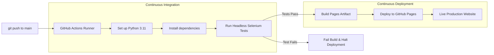

# 🎓 Student Management System (SMS)

[](https://github.com/SadiaRahman30/StudentManagementSystem/actions/workflows/ci-cd.yml)
[](https://opensource.org/licenses/MIT)
[](https://sadiarahman30.github.io/StudentManagementSystem/)

> **Live Demo:** [https://sadiarahman30.github.io/StudentManagementSystem/](https://sadiarahman30.github.io/StudentManagementSystem/)

A modern, responsive, and cloud-ready **Student Management System** web application built with clean architecture, interactive client-side state management, and an end-to-end automated testing suite with Selenium. Features a complete automated CI/CD pipeline using **GitHub Actions**.

---

## 🌟 Key Features

- **🔐 Secure Authentication Flow**:
  - Institutional login with session persistence (`localStorage`).
  - Preconfigured demo credentials for instant evaluation (`admin@sms.com` / `admin123`).
  - User registration with real-time password matching and email uniqueness verification.
  - Role badge display and secure logout.

- **📊 Dynamic Dashboard & Real-Time KPIs**:
  - Live metric summary cards: Total Students, Active Enrolled, Dynamic Average GPA, and Departments.
  - Department filtering (Computer Science, Software Engineering, IT, Electrical Engineering).
  - Status filtering (Active, On Leave, Graduated).
  - Instant live keyword search by Student Name, ID, or Email.

- **⚡ Full Student Lifecycle CRUD**:
  - **Create**: Add new students with ID, Name, Email, Department, GPA, and Status.
  - **Read**: Responsive, interactive data table with department tags and status pills.
  - **Update**: Edit existing student records with pre-filled modal forms.
  - **Delete**: Remove students with user confirmation.

- **📥 Data Export & Accessibility**:
  - One-click **Export to CSV** for records and reporting.
  - Built-in **Dark / Light Mode Toggle** with smooth transitions and theme persistence.

---

## 📁 Repository Structure

```
StudentManagementSystem/
├── index.html              # Login page & authentication gateway
├── register.html           # Student registration page
├── dashboard.html          # Interactive Student Management Dashboard
├── css/
│   └── style.css           # Modern design system, tokens & responsive styles
├── tests/
│   ├── test_1_page_load.py     # Selenium test: Page load & title verification
│   ├── test_2_invalid_login.py # Selenium test: Error handling for invalid login
│   ├── test_3_valid_login.py   # Selenium test: Successful authentication
│   ├── test_4_registration.py  # Selenium test: Dashboard access verification
│   └── test_5_dashboard.py     # Selenium test: Registration flow validation
├── run_tests.py            # CI/CD Automated Test Runner
├── requirements.txt        # Python test dependencies
├── .gitignore              # Ignored files & directories
└── README.md               # Project documentation
```

---

## 🚀 Getting Started Locally

### 1. Run the Web Application
No complex web server or build step required. Simply open `index.html` in any modern web browser:

- Double-click `index.html` in your file explorer, OR
- Serve with Python's built-in HTTP server:
  ```bash
  python3 -m http.server 8000
  ```
  Then open `http://localhost:8000` in your browser.

**Demo Credentials:**
- **Email:** `admin@sms.com`
- **Password:** `admin123`

---

## 🧪 Automated Testing Suite (CI-Ready)

All tests are written in Python using **Selenium WebDriver** and configured to run in headless Chrome (`--headless=new`), making them fully compatible with local environments, **GitHub Actions**, and **Azure Pipelines**.

### Install Test Dependencies
```bash
pip install -r requirements.txt
```

### Run All Tests via CI Test Runner
```bash
python3 run_tests.py
```

### Expected Output:
```text
=================================================================
  Student Management System - Automated CI Test Suite
=================================================================

▶ Running test_1_page_load.py ...
✔ test_1_page_load.py PASSED (4.30s)

▶ Running test_2_invalid_login.py ...
✔ test_2_invalid_login.py PASSED (4.35s)

▶ Running test_3_valid_login.py ...
✔ test_3_valid_login.py PASSED (6.58s)

▶ Running test_4_registration.py ...
✔ test_4_registration.py PASSED (6.69s)

▶ Running test_5_dashboard.py ...
✔ test_5_dashboard.py PASSED (5.52s)

=================================================================
                   TEST EXECUTION SUMMARY
=================================================================
 test_1_page_load.py        : ✔ PASSED (4.30s)
 test_2_invalid_login.py    : ✔ PASSED (4.35s)
 test_3_valid_login.py      : ✔ PASSED (6.58s)
 test_4_registration.py     : ✔ PASSED (6.69s)
 test_5_dashboard.py        : ✔ PASSED (5.52s)
-----------------------------------------------------------------
 Total: 5/5 Passed in 27.43s
=================================================================

🎉 ALL TESTS PASSED! CI BUILD VERIFIED.
```

---

---

## 🔄 CI/CD Pipeline Architecture

This repository uses **GitHub Actions** to automate continuous integration and continuous delivery:



### Pipeline Workflow (`.github/workflows/ci-cd.yml`)
1. **CI Job (`test`)**:
   - Triggers on every `push` to `main` and on `pull_request`.
   - Spins up an `ubuntu-latest` virtual machine.
   - Installs Python 3.11, Google Chrome, and Selenium dependencies.
   - Runs `python run_tests.py`.
2. **CD Job (`deploy`)**:
   - Depends on the `test` job passing successfully.
   - Packages and securely deploys the web application to **GitHub Pages**.
   - Generates the live production URL.

